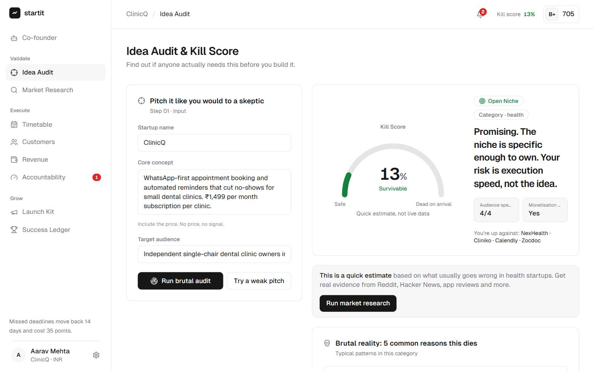
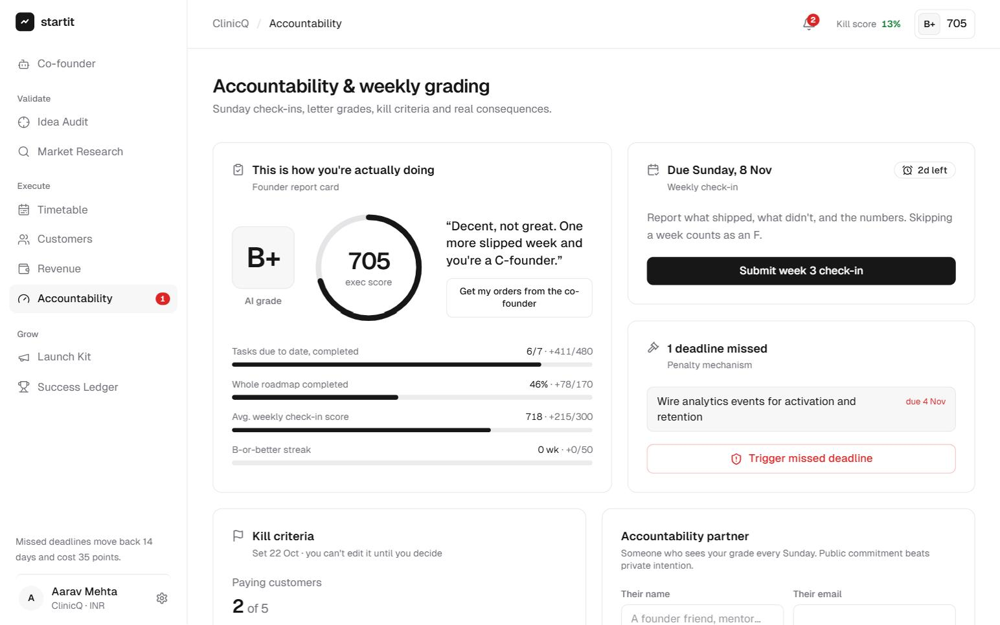
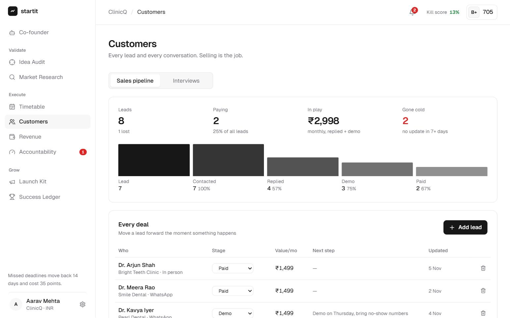
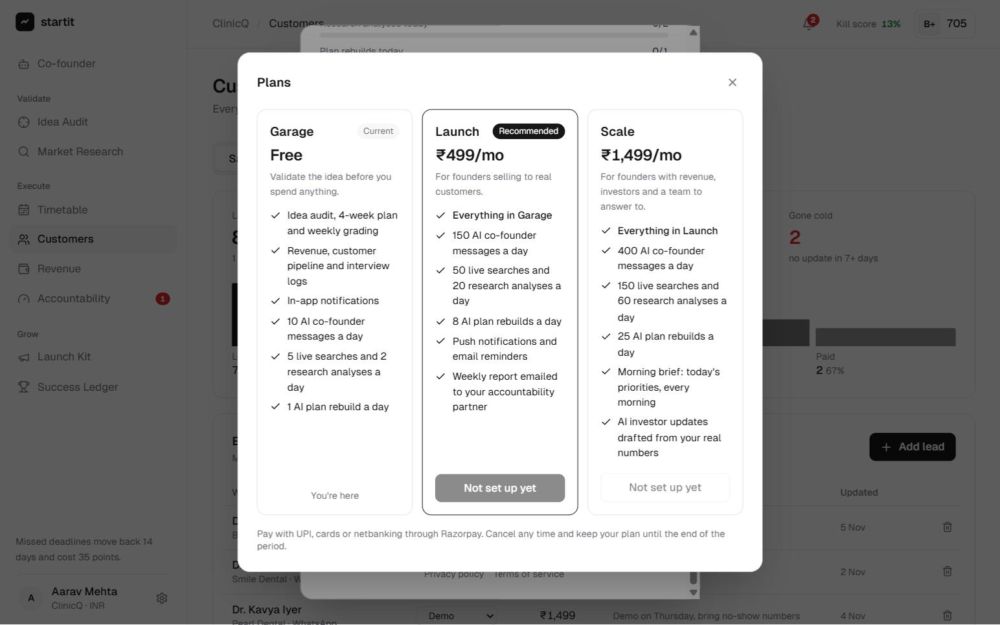
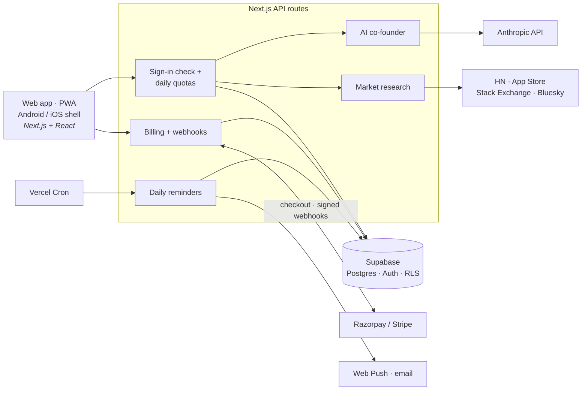

# STARTIT

**An AI co-founder that tells founders the truth.** STARTIT takes a startup from a raw idea to paying customers: it stress-tests the idea against real customer complaints, builds a week-by-week execution plan, grades the founder every Sunday, and penalises missed deadlines.

**[Live demo →](https://startit-arshfaye.vercel.app)** Sign in with any name and email, then pick **Explore a sample** to see every screen with data. In the demo, data stays in your browser and the AI is switched off.

Most AI tools for founders praise every idea and hand over a static business plan. STARTIT does the opposite. It's blunt, it works from the founder's real numbers, and it makes them do the uncomfortable parts: talking to customers, selling, and deciding when to quit.

<p>
  
  
</p>
<p>
  
  
</p>

## Features

**Validate**
- **Idea audit:** a 0–100 Kill Score, saturation rating, the five most likely ways the idea dies, and a pivot to a smaller, unserved niche.
- **Market research:** pulls real posts and reviews from Hacker News, App Store reviews, Stack Exchange and Bluesky. The AI clusters them into pain points with exact quotes and links, and produces an evidence-based Kill Score.

**Execute**
- **Adaptive plan:** a 4-week timetable (Validation → MVP → Launch → Growth) with custom tasks, which the AI rebuilds from what actually happened.
- **Accountability:** Sunday check-ins, letter grades, a 0–1000 execution score, and a 14-day penalty for every missed deadline.
- **Kill criteria and decision day:** founders set their own pass/fail line in advance; when the deadline passes, the app forces a written double-down, pivot or kill decision.
- **Customers:** a sales pipeline with conversion rates and its biggest leak, plus an interview log that shows which pains keep coming up.
- **Revenue:** manual logging, CSV import from Stripe, Razorpay or bank statements, MRR and run rate.

**Grow**
- **AI co-founder:** a chat that reads the founder's whole workspace and ends every answer with dated, measurable orders.
- **Launch kit, success ledger and investor passport**, plus AI-drafted investor updates built only from logged numbers.
- **Reminders:** an in-app bell, push notifications and a daily morning brief.

**Everywhere:** sign-in by email code, 46 countries with local currency, number and date formats, Garage / Launch / Scale plans billed through Razorpay (India) or Stripe, light and dark themes, installable on phones.

## Architecture



## Engineering highlights

- **Limits that can't be bypassed.** Every paid route checks the user server-side and spends from a per-user daily quota in a single atomic Postgres statement (`use_quota`), so parallel requests can't overshoot. Plans are only ever changed by signature-verified webhooks.
- **Webhook security.** HMAC-SHA256 with constant-time comparison for both providers, plus Stripe's timestamp check against replayed requests. The plan tier is read from the price or plan ID, so changes made in Stripe's billing portal sync correctly, and a Razorpay upgrade cancels the old subscription so nobody is billed twice.
- **Grounded AI.** The co-founder receives a structured dossier of the founder's real data (tasks, revenue, pipeline, interviews, research) instead of a vague prompt. In research, any quote that doesn't match a collected post is thrown out.
- **Scoring that resists gaming.** Deleting an overdue task counts as a missed deadline, so it can never raise the score. Deadlines lock once set.
- **One codebase, four ways to run.** The same code runs as a web app, an installable PWA with push notifications, a Capacitor shell for the App Store and Play Store, and a single-file preview with no backend. Features detect what's available by asking the server rather than guessing.
- **Store-ready.** Account deletion that cancels billing before deleting anything, row-level security, a privacy policy, and no web checkout inside the store apps.

## Tech stack

Next.js 14 (App Router) · React 18 · TypeScript · Tailwind CSS · Supabase (Postgres, Auth) · Anthropic API · Razorpay & Stripe · Web Push · Capacitor · Bun test · GitHub Actions

## Getting started

```bash
npm install
cp .env.example .env.local   # add ANTHROPIC_API_KEY for the AI features
npm run dev                  # http://localhost:3000
```

Without any other keys, STARTIT runs in local mode: accounts and data stay in the browser, and plan limits are off. Pick **Explore a sample** during sign-up to see every screen filled with data. Every service is optional and explained in [`.env.example`](.env.example).

## Tests

```bash
bun test
```

38 tests cover the scoring engine, currency formatting, CSV import, plans, reminders, webhook signatures, usage limits and account deletion. External services are faked, so the suite runs with no keys or network, and it runs on every push through GitHub Actions.

## Docs

- [Technical guide](docs/GUIDE.md): how each part works and how to configure it.
- [Launch guide](docs/LAUNCH.md): from a web app to the App Store and Play Store, with costs.

## Status

In active development and not yet launched. Next up: native push notifications and in-app purchases for the store apps.

---

Built by **Arsh Faye** · [GitHub](https://github.com/arshfaye) · [LinkedIn](https://www.linkedin.com/in/arsh-faye-6766b9357)
